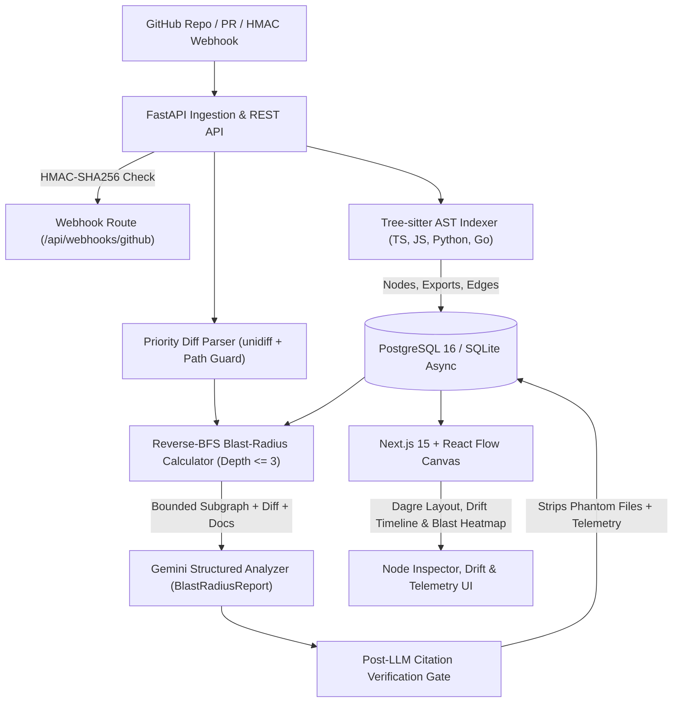

# ArchRadar — Living Architecture Mapper & PR Blast-Radius Radar

**Deterministic Tree-sitter AST dependency graphs meet grounded AI risk analysis for Pull Requests.**  
Instead of asking an LLM to guess how files connect, ArchRadar parses TypeScript/JavaScript, Python, and Go repositories into a relational dependency graph, computes the exact multi-hop reverse-BFS blast radius, tracks historical snapshot architecture drift, and constrains Gemini structured outputs to verified graph citations.


---

## 60-Second Demo Preview

> **Zero-Friction Portfolio Demo Mode:** Launch the web UI (`npm run dev`) with or without a live database. Two pre-indexed repositories (`acme/saas-billing-platform` in TypeScript and `acme/order-fulfillment-api` in Python) and three pre-computed PR blast-radius scenarios load immediately—no GitHub OAuth required.

<!-- Replace with a recorded GIF or live deployment URL once hosted -->
```text
[ Demo Recording Placeholder — Record 60s walkthrough of: ]
1. Click "#42 Auth"  -> Critical blast radius lights up 9/12 files across 3 hops (score 90/100)
2. Click "#51 Webhook" -> High-risk Python HMAC return-type bug bypassing shipping webhook checks
3. Click "#47 Refactor" -> Safe internal formatter refactor (score 17/100, breaking_change=false)
4. Click any Impacted Flow -> Graph pans & zooms to affected nodes; copy Doc-Drift Markdown patch
```

### Pre-Seeded Demo Scenarios

| Scenario | Repo | Changed File | Deterministic Score | AI Risk | What It Demonstrates |
| :--- | :--- | :--- | :---: | :---: | :--- |
| **PR #42** | `acme/saas-billing-platform` (TS) | `src/lib/token.ts` | `90/100` | `CRITICAL` | Required `expectedAudience` param breaks 3 direct callers & threatens checkout, Stripe webhooks, and invoice worker (3 hops) |
| **PR #51** | `acme/order-fulfillment-api` (Py) | `app/core/security.py` | `66/100` | `HIGH` | Changing `verify_webhook_hmac` from `bool` to `SignatureCheckResult` breaks truthiness check in `shipping.py` webhook |
| **PR #47** | `acme/saas-billing-platform` (TS) | `src/lib/formatters.ts` | `17/100` | `LOW` | Internal `Intl.NumberFormat` refactor preserves `formatUsdCents` contract with zero breaking changes |

---

## System Architecture



### Core Engineering Highlights
1. **Deterministic-First Multi-Language Graph Engine:** Tree-sitter (`tree-sitter-typescript`, `tree-sitter-javascript`, `tree-sitter-python`, `tree-sitter-go`) parses source files read-only (never executing target repository code) to extract exported symbols, `tsconfig.json` `@/` path aliases, `go.mod` module-path imports, barrel re-exports (`index.ts`, `__init__.py`), and relative imports.
2. **Reverse-BFS Blast Radius + Smart Priority Diff Truncation:** Given modified files and symbols from a unified diff, `BlastRadiusCalculator` traverses reverse dependency edges up to depth 3, while `prioritize_and_truncate_diff` ranks hunks by sensitive boundaries, `in_degree` centrality, and exported signature changes before enforcing the 12,000-character token budget.
3. **Historical Architecture Drift Timeline & Cost Telemetry:** Compare any two indexed snapshots (`GET /api/repos/{id}/snapshots/diff`) with interactive timeline scrubbing and React Flow overlays for added nodes, removed edges, and coupling (`in_degree`) deltas, plus live cost/latency/citation-gate analytics (`GET /api/telemetry/summary`).
4. **Zero-Phantom Citation Gate:** Every file path cited in `AIAnalyzer` outputs (`entry_file`, `affected_files`) is verified against the repository's indexed `file_nodes` snapshot before persistence. Any unverified path is stripped and logged via `CitationValidationTelemetry`.
5. **End-to-End Schema Contracts & Security:** Backend outputs validate against strict Pydantic v2 models (`apps/api/app/schemas/`); frontend API boundaries validate every response with Zod (`apps/web/src/lib/schemas/`); `POST /api/webhooks/github` verifies `X-Hub-Signature-256` with constant-time `hmac.compare_digest` prior to parsing JSON.

---

## Evaluation Benchmark Results

ArchRadar includes a 30-case golden benchmark suite in [`evals/`](evals/) across 3 self-contained repository fixtures (`mini_saas_ts`, `mini_fastapi_py`, `mini_edge_cases`) and 5 test categories.

- **Latest Report:** [`evals/results/latest_report.md`](evals/results/latest_report.md)
- **Measured Mode:** `deterministic + simulated-llm (offline reproducible; no GEMINI_API_KEY)`
- **Reproduce Locally:**
  ```bash
  uv run --project apps/api python -m evals.run_benchmark --output evals/results/latest_report.md
  # Or benchmark live Gemini Flash responses when GEMINI_API_KEY is configured:
  uv run --project apps/api python -m evals.run_benchmark --mode live --output evals/results/latest_report.md
  ```

### Headline Metrics

| Metric | Target | Measured | Status |
| :--- | :--- | :--- | :---: |
| Import Resolution Precision (42/42 edges) | >= 98.0% | **100.0%** | PASS |
| Import Resolution Recall (42/42 edges) | >= 98.0% | **100.0%** | PASS |
| Blast-Radius Recall (<= 3 hops) | 100.0% | **100.0%** | PASS |
| Post-Gate Phantom File Citations | 0.0% | **0.0%** (119 valid / 2 intercepted) | PASS |
| Subgraph Adherence | >= 95.0% | **100.0%** | PASS |
| Risk Classification Agreement | >= 85.0% | **100.0%** (30/30 full pass) | PASS |
| Critical/High Bug False Negative Rate | <= 5.0% | **0.0%** (0/6) | PASS |
| Breaking-Change Detection Accuracy | >= 85.0% | **100.0%** | PASS |
| Documentation Drift Detection Accuracy | >= 85.0% | **100.0%** | PASS |
| Deterministic AST + BFS Latency (Median / P95) | < 200 ms | **0.10 ms / 0.20 ms** | PASS |
| End-to-End Pipeline Latency (Median / P95) | < 3,000 ms | **0.38 ms / 0.99 ms** | PASS |
| Avg Tokens / PR (Prompt + Completion) | ~4,900 tok | **1,283 + 216 tok** | PASS |

### Category Breakdown

| Category | Cases | Full Pass | Blast Recall | Risk Agreement | Breaking Acc | Doc-Drift Acc |
| :--- | ---: | :---: | ---: | ---: | ---: | ---: |
| `benign_low_risk` | 7 | 7/7 | 100.0% | 100.0% | 100.0% | 100.0% |
| `direct_1hop_break` | 7 | 7/7 | 100.0% | 100.0% | 100.0% | 100.0% |
| `transitive_break` | 6 | 6/6 | 100.0% | 100.0% | 100.0% | 100.0% |
| `doc_drift` | 5 | 5/5 | 100.0% | 100.0% | 100.0% | 100.0% |
| `adversarial_edge` | 5 | 5/5 | 100.0% | 100.0% | 100.0% | 100.0% |

---

## Known Limitations & Failure Log

We track benchmark improvements and architectural boundaries openly from [`evals/results/latest_report.md`](evals/results/latest_report.md):

1. **Resolved Failure — `case_030_adversarial_massive_noisy_diff` (29/30 → 30/30 full pass):**  
   - *Before (V1.0 prefix truncation):* `truncated_diff` sliced linearly at 12,000 characters, so ~13 KB of noisy generated comments in `src/styles/theme.ts` pushed the breaking `src/lib/crypto.ts` (`verifyHmacSignature` → `verifyWebhookSignature`) hunk past the cutoff (`risk=low`, `breaking=False`, **29/30 / 96.7%**).  
   - *After (V1.1 Smart Priority Diff Truncation):* `prioritize_and_truncate_diff` and `AIAnalyzer.prepare_diff_for_prompt` score each hunk by sensitive boundaries, graph `in_degree`, exported signature edits, and non-comment signal before enforcing the 12,000-character budget. `src/lib/crypto.ts` is promoted ahead of comment noise, resolving `case_030` (`risk=high`, `breaking=True`) and lifting the suite to **30/30 (100.0%)** while preserving the \$0.32 / 1,000 PRs token budget.
2. **Computed Dynamic Imports:** Static `import('./plugin')` and `require('./legacy')` inside functions resolve at 100% accuracy (including after fixing an early-return bug in `TypeScriptAdapter._walk_node` discovered by this benchmark), whereas runtime-computed template imports like ``import(`./plugins/${name}`)`` cannot be resolved statically without executing target code.
3. **Depth-0 Symbol Matching Across Barrel Re-Exports:** Symbol-overlap precision filtering runs on direct edges at depth 0 (`changed_symbols_by_file`), then widens to file-level BFS at hops 1–3 so barrel chains (`leaf.ts -> sub/index.ts -> index.ts -> caller.ts`) are never dropped.
4. **Offline Simulator vs. Live Model Variance:** Offline runs use `SimulatedGroundedLLMProvider` over the exact bounded prompt (`user_prompt` JSON subgraph + prioritized diff + doc excerpts) to verify prompt-injection resistance, citation stripping (2/2 probes intercepted), and pipeline contracts reproducibly without network calls. Live Gemini numbers vary with model version and temperature.

---

## Cost per 1,000 PRs Breakdown

At Gemini Flash-class pricing (**\$0.15 / 1M input tokens**, **\$0.60 / 1M output tokens**):

| Approach | Avg Input / PR | Avg Output / PR | Cost / PR | Cost / 1,000 PRs |
| :--- | ---: | ---: | ---: | ---: |
| **ArchRadar (Bounded Subgraph + Diff)** — *Measured Benchmark Avg* | 1,283 tok | 216 tok | **\$0.000322** | **\$0.32** |
| **ArchRadar (Larger PR Budget)** — *PRD Upper Estimate* | 4,000 tok | 900 tok | **\$0.001140** | **\$1.14** |
| **Naive Full-Repo Prompting** — *~150k token codebase context* | 150,000 tok | 1,000 tok | \$0.023100 | \$23.10 |

Passing only the deterministic reverse-BFS subgraph and bounded diff cuts LLM token spend by **~95–98%** while eliminating phantom file hallucinations via the post-LLM citation gate.

---

## Quickstart (Local Development)

### Option A: Non-Docker Local Dev (SQLite Async — Works Immediately on Windows / macOS / Linux)

> **Prerequisites:** Python 3.12+ with [`uv`](https://docs.astral.sh/uv/), and Node.js 20+ with `npm`.

1. **Install backend & frontend dependencies:**
   ```bash
   cd apps/api
   uv sync
   cd ../web
   npm install
   ```

2. **Initialize local SQLite DB and seed the 2 demo repos + 3 PR scenarios:**
   ```bash
   cd ../../apps/api
   uv run python -m app.services.demo_seeder --database-url "sqlite+aiosqlite:///./archradar_dev.db" --init-db
   ```

3. **Start the FastAPI backend (Terminal 1):**
   ```bash
   # PowerShell:
   $env:DATABASE_URL="sqlite+aiosqlite:///./archradar_dev.db"
   uv run uvicorn app.main:app --reload --port 8000

   # macOS / Linux:
   # DATABASE_URL="sqlite+aiosqlite:///./archradar_dev.db" uv run uvicorn app.main:app --reload --port 8000
   ```

4. **Start the Next.js 15 frontend (Terminal 2):**
   ```bash
   cd apps/web
   npm run dev
   ```
   Open [http://localhost:3000](http://localhost:3000) to explore the interactive React Flow graph and PR blast-radius scenarios.

*(Tip: even if the API is stopped, the frontend boots cleanly into **Offline Demo Mode** with all 2 demo repos and 3 PR scenarios ready to explore.)*

### Option B: Docker Compose (PostgreSQL 16 + Redis)

```bash
cp .env.example .env
# Start Postgres + Redis
docker compose up -d postgres redis

# Run Alembic migrations & seed demo data
cd apps/api
uv run alembic upgrade head
uv run python -m app.services.demo_seeder
uv run uvicorn app.main:app --reload --port 8000
```

Or run the entire stack (Postgres + Redis + API + Web) in containers:
```bash
docker compose --profile full up --build
```

---

## Deployment Guide

| Component | Platform | Config File | Notes |
| :--- | :--- | :--- | :--- |
| **Frontend (`apps/web`)** | **Vercel** | [`apps/web/vercel.json`](apps/web/vercel.json) | Root Directory: `apps/web`. Set `NEXT_PUBLIC_API_URL` and `API_INTERNAL_URL` to your deployed API URL. |
| **Backend (`apps/api`) + Postgres** | **Render** *(Blueprint)* | [`render.yaml`](render.yaml) | Deploys `archradar-api` Docker service + managed PostgreSQL 16 with automatic `alembic upgrade head` & demo seeding (`SEED_DEMO_ON_STARTUP=true`). |
| **Backend (`apps/api`)** | **Fly.io** *(Alternative)* | [`apps/api/fly.toml`](apps/api/fly.toml) | Set `DATABASE_URL`, `GEMINI_API_KEY`, `GITHUB_WEBHOOK_SECRET`, and `CORS_ORIGINS` via `fly secrets set`. |

> Note: ArchRadar automatically normalizes `postgres://` and `postgresql://` connection strings from managed Postgres providers into `postgresql+asyncpg://` at startup.

### Environment Variables

| Variable | Service | Required | Description |
| :--- | :--- | :---: | :--- |
| `DATABASE_URL` | `api` | Yes | Async SQLAlchemy DB URL (`postgresql+asyncpg://...` or `sqlite+aiosqlite:///...`). |
| `REDIS_URL` | `api` | No | Redis connection URL (defaults to `redis://localhost:6379/0`). |
| `CORS_ORIGINS` | `api` | Yes | Comma-separated allowed frontend origins (e.g. `https://archradar.vercel.app`). |
| `SEED_DEMO_ON_STARTUP` | `api` | No | Set `true` to idempotently seed demo repos & PR scenarios on API boot. |
| `GEMINI_API_KEY` | `api` | For AI | Google Gemini API key for live `AIAnalyzer` runs (`run_ai=true`). |
| `GEMINI_MODEL` | `api` | No | Gemini model ID (default: `gemini-2.5-flash`). |
| `GITHUB_TOKEN` | `api` | No | GitHub PAT for private repos or higher GitHub API rate limits. |
| `GITHUB_WEBHOOK_SECRET` | `api` | For Webhooks | Secret for verifying `X-Hub-Signature-256` HMAC-SHA256 webhook signatures. |
| `NEXT_PUBLIC_API_URL` | `web` | Yes | Browser-accessible URL of the FastAPI backend. |
| `API_INTERNAL_URL` | `web` | No | Server-side SSR fetch URL (defaults to `NEXT_PUBLIC_API_URL`). |

---

## Verification Commands

```bash
# 30-Case Evaluation Benchmark
uv run --project apps/api python -m evals.run_benchmark --output evals/results/latest_report.md

# Backend Lint, Typecheck & Tests
cd apps/api
uv run ruff check . ../../evals
uv run mypy app
uv run pytest -v

# Frontend Lint, Typecheck & Production Build
cd apps/web
npm run lint
npx tsc --noEmit
npm run build
```
